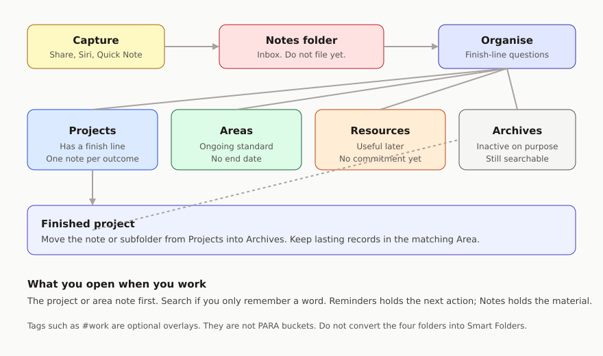

# The model

Each Notes feature has one job. Your phone or tablet already has more knobs than PARA needs. This page is the map; [setup](setup.md) is the tapping.

## Folders

Use the **iCloud** account. IMAP mailboxes and “On My iPhone” notes will not give you the tags, Smart Folders, or folder nesting this guide assumes.

| Folder | What goes in it |
| --- | --- |
| Notes (built-in) | Raw capture. Nothing here has been decided yet. This is Inbox. |
| Projects | Outcomes you are committed to finish. Default: one note per project. |
| Areas | Ongoing parts of life or work that have a standard, not a deadline. |
| Resources | Topics you are interested in and may need later. |
| Archives | Finished, paused, or obsolete items from the other three. |

Do not add a fifth folder named Inbox unless your built-in **Notes** folder is already a dump you refuse to empty. Fighting Apple’s default capture destination is extra work. Let new notes land where they land, then file them.

Subfolders are optional. Create one under **Projects** or **Areas** only when a single outcome has several notes (meeting notes, scans, a draft). A lonely subfolder for every project is the taxonomy this guide is trying to spare you.

Never convert **Projects**, **Areas**, **Resources**, or **Archives** into Smart Folders. Apple moves the notes out of the folder and tags them instead. Smart Folders are views. They are not homes. They belong in [optional extras](advanced.md).

## Notes, not databases

A note is a page. The **title** is the first line. Make it the outcome or the topic in words you would search for: “Kitchen tap fixed”, “Personal health”, “Invoice templates”.

Inside the note:

- A short **picture of done** or a one-line purpose at the top, if that helps future you.
- Headings for the chunks you will actually reopen.
- Checklists for material and open questions, not for next actions you intend to do from a context list. Those actions belong in Reminders.
- Links, scans, and photos that you need in order to use the note.

Pin one **purpose note** at the top of each of the four folders. Title them “Projects: things with a finish line”, and the matching sentence for Areas, Resources, and Archives. Six months from now you will not want to re-litigate the definitions.

## Where a new note goes

File by the next time you will *use* the note.

| If… | File in |
| --- | --- |
| You are committed to a result that will end | **Projects** |
| You must keep a standard with no end date | **Areas** |
| You might need it, with no current commitment | **Resources** |
| You are done with it, or it is on ice | **Archives** |
| You have not decided yet | Leave it in **Notes** |

When a note could be a project or an area, ask whether there is a finish line. “Write the conference talk” ends. “Teaching” does not.

When a note could be a project or a resource, ask whether you are committed *this season*. Curiosity without a commitment is a resource. The moment you agree to ship something from it, move it (or a copy of the useful parts) under **Projects**.

## Tags

Tags are an overlay, not a second PARA. If you use them at all in the core system, use two: `#work` and `#personal`. They let you filter across folders without splitting **Projects** into Work Projects and Home Projects.

Do not tag notes `#project` or `#resource`. The folder already says that. Duplicate labels go stale the first week you are busy.

You cannot lock a note that has a tag, and you cannot tag a locked note. If a note needs a lock, skip the overlay tag.

## Search, links, and pins

Retrieval in Notes is three tools:

1. **The folder you are standing in**, when you know the project or area.
2. **Search**, when you remember a word.
3. **A link to another note**, when two pages should stay related.

Pin notes you reopen every week. Unpin them when the week has moved on. A pin is not an archive policy.

## What you open

| Moment | Open |
| --- | --- |
| Something just occurred to you | A new note. Do not file it yet. |
| You are about to do a piece of work | The project or area note for that work |
| You need a fact | Search, then **Resources** |
| You are planning the week | **Projects**, then the weekly review |

## Tasks stay in Reminders

A project note can hold the outcome, the research, and the draft. The next physical action (“Email the plumber”) belongs in Reminders, tagged for the context you will do it in. Linking the two is enough: paste a reminder title into the note, or put a Notes link in the reminder. Do not maintain two competing next-action lists.
